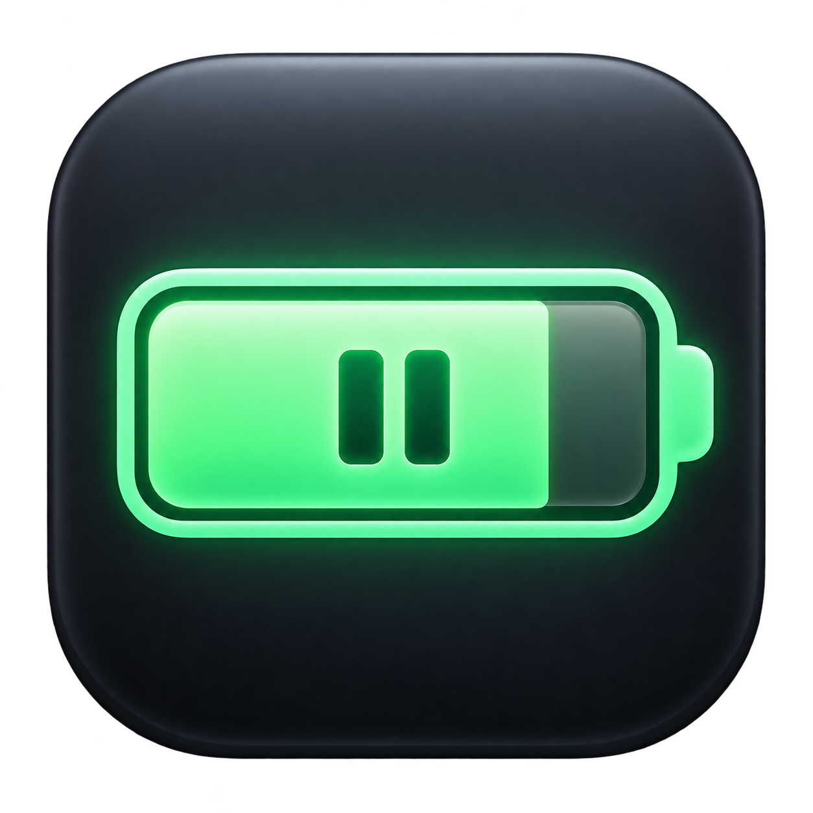

<p align="center">
  
</p>

# BatHold

**Controle de carga para seu Mac, com um app nativo na barra de menus e código aberto.**

BatHold reúne informações da bateria e controles de carga em um painel para macOS, com interface em português. Você acompanha o percentual, os ciclos e a saúde estimada, escolhe um limite oferecido pelo sistema e solicita uma carga completa quando precisa sair com o Mac.

O aplicativo usa Swift, SwiftUI e AppKit. O monitoramento consulta IOKit e o controle conversa com o serviço de carga do próprio macOS por um adaptador experimental. Todo o processamento acontece localmente, sem cadastro, servidor, telemetria própria ou dependências externas para compilar.

**Versão 0.1.0 · prova de conceito.** O controle depende de uma interface privada do macOS, que pode mudar em atualizações. Alteração e restauração do limite foram verificadas em um M1 Pro. Carga física, repouso e reinício ainda precisam de validação. Consulte [resultados e limites dos testes](docs/validation.md).

BatHold é um projeto independente, sem afiliação com Apple, BatFi ou micropixels. Um componente de diagnóstico deriva do BatFi/SMCKit sob MIT, com créditos preservados em [THIRD_PARTY_NOTICES.md](THIRD_PARTY_NOTICES.md). Nome e ícone do BatHold são próprios.

## Começar a usar

Nesta fase, a instalação é feita a partir do código-fonte. Ainda não há instalador publicado, pacote Homebrew ou versão assinada e notarizada pela Apple.

```sh
git clone https://github.com/ferreiralisson/bathold.git
cd bathold
swift test
zsh scripts/build-app.sh
open dist/BatHold.app
```

O BatHold aparece na **barra de menus**. Clique no ícone da bateria para abrir o painel. Escolher um percentual altera a configuração real de carga do macOS. Você pode copiar `dist/BatHold.app` para Aplicativos pelo Finder.

**[Leia o guia de uso completo →](docs/GUIA-DE-USO.md)**

## Funcionalidades atuais

- **Monitoramento:** percentual, conexão ao carregador e estado de carga.
- **Informações da bateria:** ciclos, saúde estimada, temperatura e potência, quando disponíveis.
- **Limite de carga:** percentuais oferecidos pelo macOS; no Mac validado, 80%, 85%, 90%, 95% e 100%.
- **Confirmação do limite:** consulta o serviço novamente depois de alterar a configuração para verificar o percentual e sua ativação.
- **Carga completa sob demanda:** solicita uma suspensão temporária do limite. O macOS gerencia a retomada; essa função ainda requer validação com carregador conectado.
- **Atualização:** consulta a cada 30 segundos, após despertar e pelo botão Atualizar.
- **Diagnóstico:** CLI com saída JSON e consultas SMC somente de leitura, sem número de série, UUID ou localização.
- **Recuperação:** teste explícito de alteração de limite que salva e restaura a configuração anterior.
- **Ícone próprio:** imagem original incluída no pacote `.app` e disponível em `Assets/`.

Início automático, notificações, gráficos e regras por horário ou localização estão no [roteiro](docs/roadmap.md); ainda não são recursos disponíveis.

## Requisitos e compatibilidade

| Componente | Requisito |
| --- | --- |
| Aplicativo | Mac com Apple Silicon e macOS 14 ou posterior |
| Compilação | Xcode ou Command Line Tools com Swift 5.9 ou posterior |
| Controle de carga | Serviço PowerUI e hardware compatíveis; a Apple documenta o limite nativo a partir do macOS 26.4 |
| Validação inicial | MacBook Pro M1 Pro, macOS 27.0.1, firmware 20457.1.29 |

O suporte ao painel não garante suporte ao controle. Se o serviço estiver ausente, inacessível ou incompatível, o app mantém o monitoramento e oferece acesso aos Ajustes de Bateria. Outras combinações de modelo, macOS e firmware precisam de testes próprios.

## Compilar o aplicativo e o CLI

Abra `Package.swift` no Xcode para editar ou use:

```sh
swift build
swift test
zsh scripts/build-app.sh
```

O script compila em release, gera o ícone `.icns`, monta o aplicativo, inclui as licenças e aplica assinatura local ad hoc. Os resultados ficam em:

| Arquivo | Uso |
| --- | --- |
| `dist/BatHold.app` | Aplicativo na barra de menus |
| `dist/bathold` | Ferramenta de linha de comando |
| `dist/LICENSE` e `dist/licenses/` | Avisos que acompanham a distribuição |

Os binários usam a arquitetura do Mac que executa a compilação; não são universais. A assinatura ad hoc serve ao desenvolvimento local. Distribuição pública com Developer ID e notarização exige credenciais próprias da Apple, que não fazem parte do repositório.

## Linha de comando

```sh
dist/bathold status           # Informações da bateria
dist/bathold diagnose         # Diagnóstico de compatibilidade em JSON
dist/bathold charge-status    # Limite e percentuais disponíveis
dist/bathold limit 80         # Altera o limite real para 80%
dist/bathold charge-full      # Solicita carga completa temporária
dist/bathold disable          # Desativa o limite
dist/bathold --help
```

O [guia de uso](docs/GUIA-DE-USO.md) explica cada operação e a recuperação. Os comandos de controle não exigem `sudo` no Mac validado.

## Comportamento e limitações

O BatHold usa o limite nativo. O macOS pode ocasionalmente carregar até 100% para manter a estimativa do estado de carga, conforme a [documentação da Apple](https://support.apple.com/en-ie/102338).

O backend PowerUI é privado e experimental. A implementação verifica a presença e as assinaturas da interface, aceita apenas percentuais informados pelo serviço e consulta o estado após alterações. Isso não garante estabilidade entre versões nem aprovação na Mac App Store.

Não há escrita no SMC, daemon próprio, instalação privilegiada ou alteração de SIP. Limites abaixo de 80%, descarga forçada e controle de MagSafe não estão implementados. A saúde é uma estimativa pela capacidade nominal em relação à capacidade de projeto, limitada a 100%; não substitui o diagnóstico de saúde da Apple. Métricas ausentes aparecem como indisponíveis.

**Sair do app não desativa automaticamente o limite configurado no sistema.** Para removê-lo, use Desativar limite ou os Ajustes de Bateria do macOS.

## Testes

```sh
swift test
zsh scripts/build-app.sh
dist/bathold status
dist/bathold charge-status
```

Os quatro testes automatizados verificam capacidades, descarga negativa, conversão de temperatura, saúde estimada e tratamento de métricas ausentes ou inválidas. Não modificam a configuração de carga.

O teste de escrita é separado e **altera temporariamente o limite**:

```sh
mkdir -p artifacts
dist/bathold verify-control artifacts/recovery.json
```

Ele salva a configuração, aplica outro percentual, verifica e restaura o estado anterior. Execute sem uma carga temporária já em andamento. Leia o [guia de recuperação](docs/GUIA-DE-USO.md#testar-e-restaurar-o-controle).

## Organização do projeto

| Caminho | Conteúdo |
| --- | --- |
| `Sources/BatteryMenu/` | Painel SwiftUI na barra de menus |
| `Sources/BatteryCLI/` | Diagnóstico, controle e recuperação |
| `Sources/BatteryCore/` | IOKit, diagnóstico SMC e verificação do controle |
| `Sources/NativeCharge/` | Adaptador Objective-C original para PowerUI |
| `Tests/BatteryCoreTests/` | Testes de interpretação da bateria |
| `Assets/` | Ícone original e descrição de sua criação |
| `scripts/` | Compilação e empacotamento local |
| `docs/` | Guia, viabilidade, validação e roteiro |
| `licenses/` | Licenças dos componentes reutilizados |

`.gitignore` exclui binários gerados, caches, relatórios locais, arquivos de ambiente, certificados e configurações pessoais. Executáveis e instaladores gerados não devem entrar nos commits.

## Licença, contribuição e reconhecimento

Copyright © 2026 Alisson Ferreira da Silva e colaboradores.

BatHold é software livre sob a **licença MIT**. Você pode estudar, usar, modificar e redistribuir o código nos termos de [LICENSE](LICENSE), preservando os avisos aplicáveis. O software é fornecido sem garantia.

O cliente SMC de leitura foi adaptado do [BatFi](https://github.com/rurza/BatFi), de Adam Różyński, com origem no [SMCKit](https://github.com/beltex/SMCKit), de beltex. Os textos MIT estão preservados no código e em `licenses/`. O framework PowerUI pertence ao macOS e não é redistribuído.

Contribuições são bem-vindas. Leia [CONTRIBUTING.md](CONTRIBUTING.md) para preparar o ambiente e validar mudanças. Para relatar problemas, abra uma [issue](https://github.com/ferreiralisson/bathold/issues) com modelo, macOS, firmware e a mensagem observada; revise o diagnóstico antes de compartilhá-lo.
